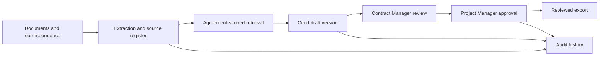

# ACE — Contract Intelligence

### Bilingual enterprise AI for contractual correspondence

Contract teams need to connect incoming correspondence to the governing agreement, relevant evidence, deadlines and an accountable review process. ACE brings those steps into a single workspace, with source-cited drafts and a recorded decision history.

**My role:** product solution design, software architecture and hands-on implementation of the contract workspace, retrieval, drafting and review workflows.

## Product capabilities

| Capability | What it supports |
| --- | --- |
| Bilingual workspace | English and Arabic contract correspondence workflows. |
| Document intelligence | Persistent documents and correspondence, text extraction/OCR and source-linked retrieval. |
| Cited drafting | Draft versions linked to supporting documents and case facts so reviewers can inspect the basis. |
| Agreement boundaries | Agreement-scoped access and evidence separation across projects and users. |
| Case workbench | Chronology, notices, facts, amendments and internal evidence packets. |
| Human review | Separate Contract Manager and Project Manager review steps, with approvals bound to the draft and evidence context. |
| Audit and export | Version history, review events and controlled preparation of reviewed document artifacts. |

## Architecture

The design connects model output to explicit sources and review decisions. A changed draft or evidence context can invalidate prior approval. Document content is treated as evidence rather than executable instructions.

## What this demonstrates

- Turning enterprise AI requirements into a working document and decision workflow.
- Building retrieval, versioning, access controls and human review around generated content.
- Connecting business roles and agreement boundaries to application behavior.
- Carrying a product from solution architecture into an implemented demonstration and evaluation workflow.

## Technology

TypeScript/JavaScript, React, a Node.js API, persistent application storage, Python document extraction, PDF/OCR tooling and configurable local model inference.

## Demonstration status

ACE was developed around an **ADNOC-focused contract administration opportunity**. Demonstrations use synthetic records. This showcase does not claim an ADNOC production deployment, client endorsement or enterprise acceptance. Live connectors, the actual authority matrix and production rollout require separate validation.

This repository is a **public product and architecture showcase**. Application source, deployment configuration and private project material are maintained separately. It is not an installable source distribution.

[About Karthik Bala](https://github.com/karthikbala) · [LinkedIn](https://www.linkedin.com/in/karthikbalait/)
